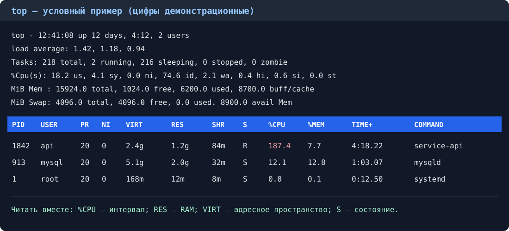
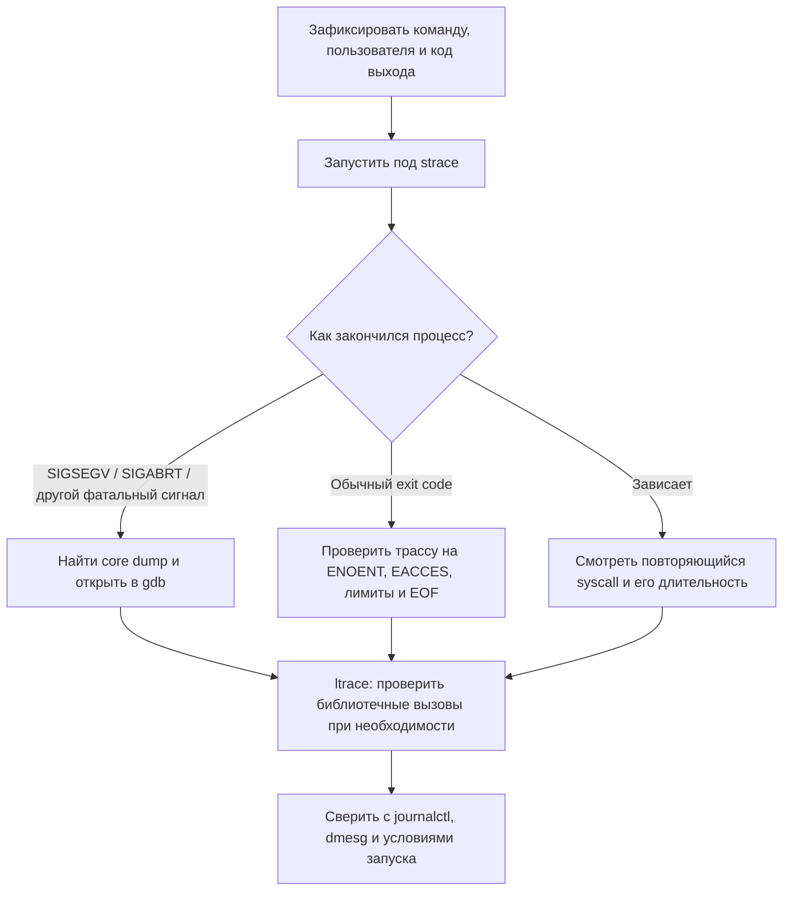

# Linux: конспект для технических собеседований

Практический разбор четырёх вопросов: `top`, ресурсы процесса, диагностика неизвестного падающего бинарника и медленный `ls -li`. Команды ориентированы на Linux; отдельные опции могут отличаться в BusyBox, macOS и разных версиях дистрибутива. Проверяйте локальные `man`-страницы.

> Во втором вопросе я трактую «ремурмов» как **ресурсов**. У процесса нет одного универсального числа «сколько ресурсов»: обычно проверяют память, CPU, потоки, открытые файловые дескрипторы, ввод-вывод и ограничения.

## 1. `top`: читать состояние системы и процессов

`top` — интерактивный монитор: он периодически читает счётчики ядра и показывает нагрузку системы и процессы. Значения CPU — это доля за интервал между обновлениями; память и часть других столбцов — моментальный снимок.

Запустить:

```bash
top                 # интерактивно, обновление обычно раз в несколько секунд
top -d 1            # обновлять примерно раз в секунду
top -p 1234         # следить за PID 1234
top -u appuser      # показывать процессы пользователя
top -H -p 1234      # показывать потоки процесса
top -b -n 1         # один снимок в batch-режиме для скрипта/сбора вывода
```

Иллюстрация ниже — условный экран, чтобы запомнить, где искать ключевые значения. Числа демонстрационные.



### Верхняя часть экрана

| Строка | Что означает | На что смотреть |
|---|---|---|
| `up ...`, `load average` | Время работы и средняя нагрузка за 1, 5 и 15 минут | Тренд и соотношение с числом CPU; load — не процент CPU |
| `Tasks` | Количество задач, часто включая процессы и потоки, и их состояния | Растёт ли число `zombie`; много `D` может указывать на ожидание I/O |
| `%Cpu(s)` | Распределение CPU за интервал | `us`, `sy`, `id`, `wa`, `st` и другие поля ниже |
| `MiB Mem`, `MiB Swap` | Память и swap | Смотрите на `available` в `free`, а не только на `free` из строки памяти |

#### CPU: `us`, `sy`, `ni`, `id`, `wa`, `hi`, `si`, `st`

- `us` — выполнение кода в user space.
- `sy` — выполнение кода ядра от имени процессов: системные вызовы, драйверы и прочая работа ядра.
- `ni` — user-space время процессов с изменённым nice.
- `id` — простаивание CPU.
- `wa` — время, когда CPU простаивает, ожидая завершения I/O. Высокий `wa` — сигнал проверить диски/сеть, но сам по себе не доказывает, что диск неисправен.
- `hi`, `si` — аппаратные и программные прерывания.
- `st` — время, отнятое гипервизором у виртуальной машины.

`load average` считает задачи, которые готовы выполняться, и задачи в непрерываемом ожидании (обычно I/O); это не «процент занятости». На машине с 8 логическими CPU load около 8 может означать полную очередь, но интерпретировать нужно вместе с `id`, `wa`, числом CPU и типом нагрузки. Для числа CPU: `nproc`.

#### Память

`top` показывает физическую память и swap в верхней сводке. Linux использует свободную память под файловый кеш; этот кеш в значительной степени можно освободить при необходимости. Поэтому низкое значение `free` само по себе не означает нехватку памяти. Проверьте:

```bash
free -h
grep -E 'MemAvailable|MemFree|Cached|Swap' /proc/meminfo
```

`available` — более полезная оценка памяти, доступной новым приложениям без активного swap. Конкретное поле `available` зависит от ядра и утилиты `free`.

### Столбцы таблицы процессов

| Столбец | Значение |
|---|---|
| `PID` | Идентификатор процесса в текущем PID namespace |
| `USER` | Владелец процесса |
| `PR`, `NI` | Приоритет планировщика и nice; меньший nice обычно даёт больше CPU-веса в рамках обычного планирования |
| `VIRT` | Виртуальное адресное пространство: отображённые файлы, разделяемая память, зарезервированные области и resident-страницы |
| `RES` | Резидентная память процесса — страницы, сейчас находящиеся в RAM |
| `SHR` | Оценка разделяемой части резидентной памяти; это не точное «сколько RAM вернётся при завершении процесса» |
| `S` | Состояние: `R` выполняется/готов, `S` спит, `D` ждёт непрерываемую операцию, `T` остановлен/трассируется, `Z` zombie |
| `%CPU` | Использование CPU за интервал обновления. На многопроцессорной машине процесс может показывать больше 100% в режиме, где 100% соответствует одному CPU |
| `%MEM` | Доля резидентной памяти процесса от общей физической памяти; это не `VIRT` |
| `TIME+` | Накопленное CPU-время процесса, обычно с долями секунды |
| `COMMAND` | Имя команды; часто можно переключить на полную командную строку |

Не делайте вывод о памяти только по `VIRT`: большое адресное пространство не равно такому же объёму занятой физической RAM. Для точной картины дополните `top` данными из `/proc/PID/smaps_rollup`, `pmap` или cgroup.

### Полезные клавиши `top`

| Клавиша | Действие |
|---|---|
| `q` | Выйти |
| `1` | Развернуть/свернуть отображение CPU по ядрам |
| `P` | Сортировать по CPU |
| `M` | Сортировать по памяти |
| `T` | Сортировать по накопленному времени CPU |
| `H` | Переключить отображение потоков |
| `u` | Отфильтровать по пользователю |
| `k` | Отправить сигнал процессу — осторожно; проверьте PID перед подтверждением |
| `f` | Выбрать отображаемые поля (в зависимости от сборки) |
| `W` | Сохранить настройки `top` в конфигурацию пользователя |

У `top` есть режим нормализации CPU (Irix/Solaris); клавиша `I` переключает его в типичных версиях procps-ng. Из-за этого сравнение `%CPU` между машинами или настройками может быть некорректным, если забыть режим. На серверах сверяйте поведение с `man top`.

### Пример интерпретации

Представим: один PID стабильно показывает `250% CPU`, `RES` около `1.2 GiB`, а `wa` низкий. Вероятный вывод: процесс одновременно загружает примерно 2–3 логических CPU, и это не похоже на ожидание диска. Следующие шаги:

```bash
ps -p 1234 -o pid,ppid,stat,%cpu,%mem,rss,vsz,nlwp,etime,cmd
pidstat -p 1234 1       # если установлен пакет sysstat
top -H -p 1234          # понять, какой поток нагружает CPU
```

Это гипотеза, не диагноз. Чтобы найти место выполнения CPU-кода, используйте профилировщик (`perf`, если доступен и разрешён), а не делайте вывод только по одной строке `top`.

### Самопроверка

1. Чем `RES` отличается от `VIRT`?
2. Почему `load average = 12` не обязательно означает 1200% CPU?
3. Что проверить, если процесс в состоянии `D`?

## 2. Как узнать, сколько ресурсов использует один процесс

Сначала определите PID и выберите конкретный ресурс. Например:

```bash
pgrep -a -f 'имя_или_часть_командной_строки'
PID=1234
```

Не используйте имя процесса как единственный критерий: два разных процесса могут иметь похожую командную строку. Проверьте пользователя, PID, родителя и время запуска.

| Что измеряем | Команда | Что показывает |
|---|---|---|
| CPU, RAM, статус, число потоков | `ps -p "$PID" -o pid,ppid,stat,%cpu,%mem,rss,vsz,nlwp,etime,cmd` | Снимок основных метрик; `RSS` и `VSZ` обычно в KiB |
| CPU во времени | `pidstat -u -p "$PID" 1` | Периодический CPU-снимок, если установлен `sysstat` |
| Потоки | `ps -L -p "$PID" -o pid,tid,psr,stat,%cpu,comm` | Строка на каждый поток |
| Открытые файловые дескрипторы | `find "/proc/$PID/fd" -mindepth 1 -maxdepth 1 -type l | wc -l` | Число открытых FD в момент измерения |
| Что именно открыто | `lsof -nP -p "$PID"` | Файлы, сокеты, pipes и другие открытые объекты, если установлен `lsof` |
| Пределы процесса | `cat "/proc/$PID/limits"` | Soft/hard limits, например `Max open files` |
| Сводка памяти | `grep -E 'Vm(Size|RSS|Data|Stk)|Threads|FDSize' "/proc/$PID/status"` | Поля из procfs; `FDSize` — размер таблицы дескрипторов, **не** точное число открытых FD |
| Подробная память | `cat "/proc/$PID/smaps_rollup"` | Сводная статистика отображённых страниц (доступность зависит от ядра/прав) |
| Счётчики I/O | `cat "/proc/$PID/io"` | Байты чтения/записи и системные счётчики процесса |
| Ресурсы cgroup | `cat /proc/$PID/cgroup` и `systemd-cgtop` | К какому cgroup относится процесс и использование на уровне группы |

Для общего снимка ресурсов без дополнительного кода:

```bash
ps -p "$PID" -o pid,stat,%cpu,%mem,rss,vsz,nlwp,etime,cmd
printf 'FD count: '
find "/proc/$PID/fd" -mindepth 1 -maxdepth 1 -type l 2>/dev/null | wc -l
cat "/proc/$PID/limits"
```

**Ограничения измерений:** `/proc` отражает моментальный снимок и может измениться между командами; для исчезнувшего PID каталог пропадёт. PID может быть виден в другом namespace под другим номером. На контейнере смотрите cgroup-лимит, иначе сравнение с общей памятью хоста может ввести в заблуждение. Часть данных скрыта правами (`hidepid`, capabilities, контейнерные ограничения).

Не путайте `ulimit -n` текущей оболочки с лимитом уже работающего процесса. Для конкретного PID проверяйте `/proc/PID/limits`.

## 3. Падает бинарник: исходников и логов нет

`strace` — хороший первый шаг, потому что он показывает границу процесса с ядром: системные вызовы, аргументы, результаты и сигналы. `ltrace` полезен для динамических вызовов библиотек. Ни один из них сам по себе не заменяет core dump и debugger.

### Шаг 1. Зафиксировать условия и код завершения

Запишите точный путь/аргументы, пользователя, рабочий каталог, окружение, stdin, время сбоя и exit code. Если запуск через systemd, исследуйте unit и его журнал, а не только ручной запуск от своего пользователя.

```bash
file ./app
readelf -h -l -d ./app | less
./app --arg value
rc=$?
printf 'exit code: %s\n' "$rc"
```

`file`/`readelf` помогают проверить формат ELF, архитектуру, интерпретатор и динамические зависимости. `ldd` применяйте только к доверенному бинарнику: анализ неизвестного исполняемого файла безопаснее начинать с `readelf -d`/`objdump -p`, а не запускать его через помощник, связанный с динамическим загрузчиком.

### Шаг 2. Записать системные вызовы и сигнал

```bash
strace -ff -ttt -T -s 256 -yy -o /tmp/app.strace -- ./app --arg value
```

- `-f` следует за fork/clone/exec; `-ff` обычно создаёт отдельный файл на PID.
- `-ttt` добавляет timestamp; `-T` — длительность вызова.
- `-s 256` увеличивает максимальную длину отображаемых строк.
- `-yy` старается подробнее декодировать содержимое file descriptor.
- `-o` отправляет трассу в файл; иначе большой вывод смешается со stderr приложения.

Начните с хвоста трассы:

```bash
grep -hE 'SIG(SEGV|ABRT|BUS|ILL|FPE)| = -1 (ENOENT|EACCES|ENOMEM|EMFILE|ENFILE)' /tmp/app.strace.*
tail -n 80 /tmp/app.strace.*
```

Ищите: `ENOENT` (ожидаемый файл отсутствует), `EACCES` (права/путь), `ENOMEM` (память), `EMFILE` (лимит FD процесса), неожиданное чтение EOF, последний `execve()` и завершающий сигнал `SIGSEGV`/`SIGABRT`/другой. Ошибочный вызов может быть штатной проверкой приложения; важна последовательность событий, а не первая строка `= -1`.

Для уже работающего процесса можно подключиться:

```bash
strace -ff -tt -T -p "$PID" -o /tmp/app.attach.strace
```

Подключение через ptrace может быть запрещено политикой безопасности, контейнером или настройками ядра. Трассировка добавляет задержки и может изменить race condition или тайминг. Трассы способны содержать аргументы, пути и данные приложения — храните их как диагностические логи с соответствующим уровнем доступа.

### Шаг 3. Посмотреть вызовы библиотек с `ltrace`

```bash
ltrace -f -tt -T -s 256 -o /tmp/app.ltrace -- ./app --arg value
```

`ltrace` показывает вызовы динамических библиотек/символов. Это помогает заметить, например, ошибку `malloc`, проблему конфигурации через libc или вызов API библиотеки непосредственно перед падением. Он может ничего полезного не показать для статически слинкованного бинарника, вызовов без распознаваемых символов, прямых системных вызовов или несовместимого ABI.

Чтобы вместе видеть библиотечные вызовы и системные вызовы, у многих сборок есть `-S`; проверьте `ltrace --help`/`man ltrace` на своей системе. Начинайте с одной трассы: комбинация трассировщиков ещё больше меняет тайминг.

### Шаг 4. Получить core dump и символический стек

При `SIGSEGV`, `SIGABRT` и других фатальных сигналах core dump часто даёт больше сведений, чем трасса системных вызовов: стек, регистры и состояние потоков на момент падения.

```bash
ulimit -c                 # лимит core dump текущей оболочки
ulimit -c unlimited       # разрешить core для процессов, запущенных из этой оболочки
coredumpctl list         # если хост использует systemd-coredump
coredumpctl info <PID>
coredumpctl debug <PID>  # обычно откроет debugger, часто gdb
```

Для сохранённого локального core:

```bash
gdb ./app /path/to/core
(gdb) bt
(gdb) thread apply all bt full
(gdb) info registers
```

Нужно совпадение core с точным бинарником и библиотеками; без debug symbols имена функций могут быть неполными, но адреса и стек всё равно полезны. `ulimit -c unlimited` влияет на процессы этой оболочки и их потомков. Для systemd-сервиса проверьте `LimitCORE=`, `kernel.core_pattern`, свободное место и конфигурацию `systemd-coredump` — изменение `ulimit` в своей консоли не меняет лимит сервиса.

### Шаг 5. Проверить сообщения ядра и сервиса

```bash
journalctl -u имя.service --since '30 minutes ago'
journalctl -k --since '30 minutes ago'
dmesg -T | tail -n 100
```

Ищите OOM-killer, segfault, отказ SELinux/AppArmor, недоступный mount, ошибку драйвера, рестарт по watchdog и сообщения загрузчика. Для контейнера проверьте также exit code контейнера, cgroup memory events и журнал runtime.

### Диагностическая развилка



### Короткий ответ для интервью

«Сначала воспроизведу запуск с теми же аргументами, пользователем и окружением, зафиксирую exit code. Затем запущу `strace -ff -tt -T -s 256 -o ...`, чтобы увидеть syscalls и сигналы, проверю ошибочные возвраты и последние события. Если процесс завершился фатальным сигналом, найду core dump (`coredumpctl`) и посмотрю стек в `gdb`. `ltrace` добавлю для динамических библиотечных вызовов. Параллельно проверю `journalctl`, `dmesg`, loader/ABI и limits. Учту, что ptrace меняет timing и что трассы могут содержать чувствительные данные.»

### Самопроверка

1. Что показывает `strace`, а чего не показывает `ltrace`?
2. Почему `strace` иногда меняет поведение падающей программы?
3. Что можно понять из `SIGSEGV`, если последний syscall завершился успешно?

## 4. Почему обычный `ls` быстрый, а `ls -li` медленный

Ключевое различие: `ls` без длинного формата в основном получает имена из записей каталога, тогда как `-l` просит метаданные каждого элемента: тип/права, число ссылок, владельца, группу, размер и время. Реализация обычно делает для множества записей дополнительные операции получения атрибутов (`statx`, `newfstatat` и т.п.). На локальном SSD это может быть незаметно; на огромном каталоге, холодном кеше, NFS/SMB/FUSE или перегруженном сервере — дорого.

`-i` добавляет отображение inode. Сам по себе `-i` **не обязательно** требует отдельного `stat` для каждого имени: файловая система может уже передавать inode с записью каталога. Поэтому если сравниваются `ls` и `ls -li`, основная дополнительная работа чаще связана с длинным форматом `-l`, а не только с `-i`. Для точного ответа нужно смотреть фактическую реализацию, файловую систему и системные вызовы.

Еще один фактор — `--color=auto`: GNU `ls` при настройке цветов может запрашивать тип/метаданные каждого файла, чтобы отличить исполняемые файлы, каталоги и ссылки. Для чистого сравнения отключите цвет и сортировку:

```bash
LC_ALL=C time ls -1U --color=never . >/dev/null
LC_ALL=C time ls -iU --color=never . >/dev/null
LC_ALL=C time ls -lU --color=never . >/dev/null
```

- `-1` — по одному имени на строку.
- `-U` — не сортировать; снижает влияние сортировки и сравнивает операции ближе к чтению каталога.
- `--color=never` — не выполнять работу ради цветовой классификации.
- `>/dev/null` — не тратить время на вывод огромного списка в терминал.
- `LC_ALL=C` — уменьшить влияние локали на сортировку/форматирование.

Чтобы проверить, добавляет ли именно длинный формат метаданные, посчитайте системные вызовы:

```bash
strace -c -e trace=getdents64,newfstatat,statx ls -lU --color=never . >/dev/null
```

Ожидайте много `getdents64` для чтения имён и потенциально много `newfstatat`/`statx` для статусов. Набор syscall зависит от libc, coreutils и FS. `ls -iU` отдельно помогает увидеть поведение получения inode в данной системе.

**Как отвечать на вопрос:** «Обычный `ls` часто обходится данными каталога и выводит имена; `-l` просит атрибуты для каждой записи, то есть может вызвать массу `statx/newfstatat`. Это дорого на сетевой или медленной ФС и при большом каталоге. Но `-i` отдельно не всегда требует дополнительного stat: inode часто уже есть в `readdir`. Я бы сравнил `ls -1U --color=never` и `ls -lU --color=never`, затем посмотрел `strace -c`.»

## Что ещё изучать по Linux для собеседований

У вас подходящая отправная точка: **«Внутреннее устройство Linux» (How Linux Works), Брайан Уорд, 3-е издание**. Используйте книгу как карту системных понятий, а детали современных команд сверяйте с `man` и документацией ядра: systemd, cgroups и утилиты развиваются отдельно от текста книги.

Рекомендуемый порядок:

1. **Shell и базовая диагностика:** quoting, pipe/redirect, exit code, `grep`, `find`, `xargs`, `sed`, `awk`, `journalctl`.
2. **Процессы и потоки:** `fork/exec/wait`, PID/PPID, состояния, сигналы, jobs, zombie/orphan, threads, `/proc`, планировщик CPU, nice.
3. **CPU и производительность:** load average, context switches, interrupts, `top`, `ps`, `pidstat`, `vmstat`, `iostat`, основы `perf`.
4. **Память:** виртуальное адресное пространство, page tables, RSS/VIRT/PSS, page cache, swap, overcommit, OOM-killer, cgroups memory.
5. **Файлы и диски:** inode, dentry, hard/soft links, open file description и FD, permissions/ACL/capabilities, mount, VFS, ext4/XFS, `df` против `du`, `iostat`.
6. **Syscalls и отладка:** ELF, dynamic loader, shared libraries, `strace`, `ltrace`, core dumps, `gdb`, `readelf`, `objdump`.
7. **Загрузка и сервисы:** init/systemd, unit dependencies, journald, boot process, targets, restart policy, limits, timers.
8. **Сеть:** адреса и маршруты, DNS, TCP handshake/retransmit, sockets, listening ports, firewall/nftables, `ss`, `ip`, `dig`, `tcpdump`.
9. **Безопасность и изоляция:** user/group, sudo, namespaces, cgroups, seccomp, SELinux/AppArmor, контейнеры.

### Как превратить книгу в подготовку к интервью

После каждой главы выпишите: 5 понятий, 5 команд с интерпретацией вывода и 3 вопроса «что проверю, если…». Делайте маленькие лабораторные упражнения в VM/контейнере: запустить процесс и изучить `/proc`, ограничить память cgroup, поймать сигнал, открыть core dump, сравнить syscalls для двух вариантов `ls`. Не выполняйте эксперименты с `kill`, лимитами или core dump на рабочем сервисе.

На интервью отвечайте в последовательности: **симптом → гипотезы → команда, которая различит гипотезы → как прочитать её результат → следующий шаг**. Не перечисляйте команды без объяснения, какое наблюдение они дадут.

## Первичные справочники

- [`top(1)` — procps-ng](https://www.man7.org/linux/man-pages/man1/top.1.html)
- [`proc(5)` — procfs и `/proc`](https://man7.org/linux/man-pages/man5/proc.5.html)
- [`proc_pid_fd(5)` — файловые дескрипторы процесса](https://man7.org/linux/man-pages/man5/proc_pid_fd.5.html)
- [`proc_pid_status(5)` — статус и счётчики процесса](https://man7.org/linux/man-pages/man5/proc_pid_status.5.html)
- [`strace(1)`](https://man7.org/linux/man-pages/man1/strace.1.html)
- [`ltrace(1)`](https://www.man7.org/linux/man-pages/man1/ltrace.1.html)
- [`core(5)` и core dump](https://man7.org/linux/man-pages/man5/core.5.html)
- [`coredumpctl(1)`](https://www.man7.org/linux/man-pages/man1/coredumpctl.1.html)
- [GNU Coreutils: `ls`](https://www.gnu.org/software/coreutils/manual/html_node/ls-invocation.html)
- [`stat(2)` — получение метаданных файла](https://man7.org/linux/man-pages/man2/stat.2.html)
